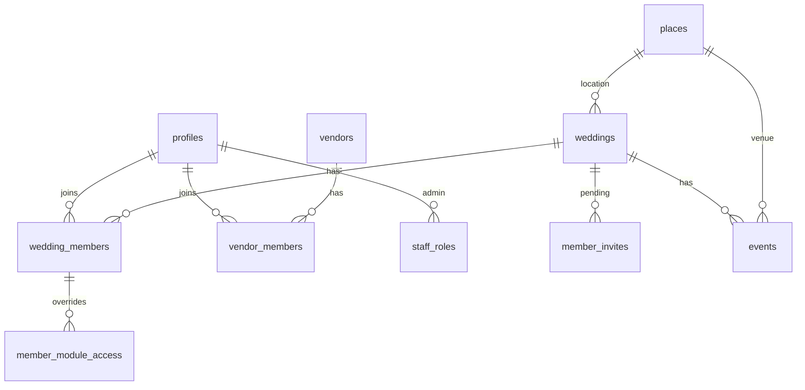
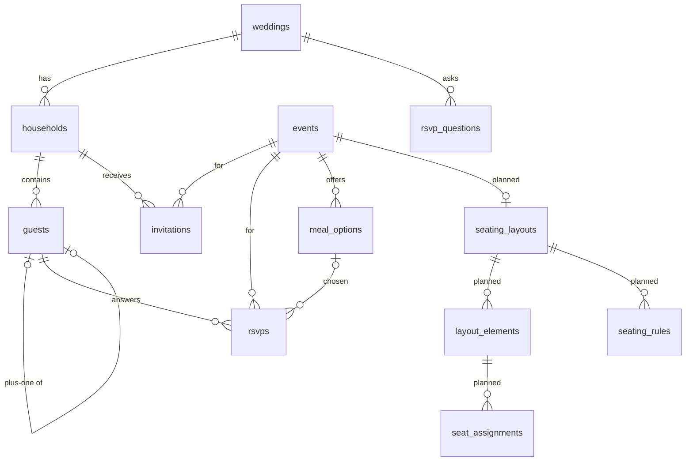
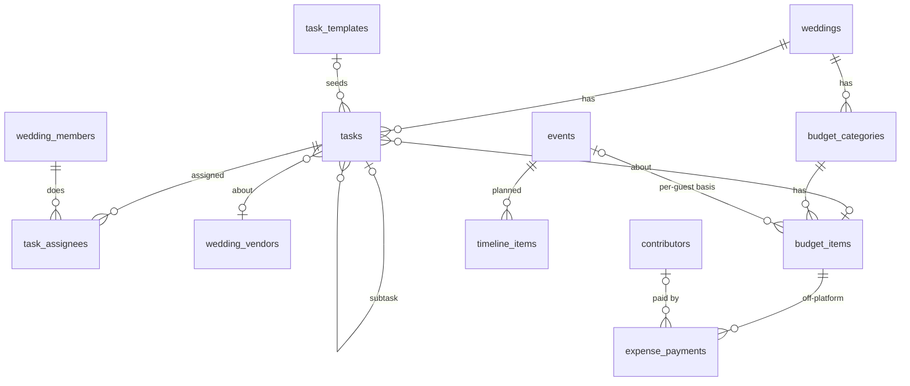
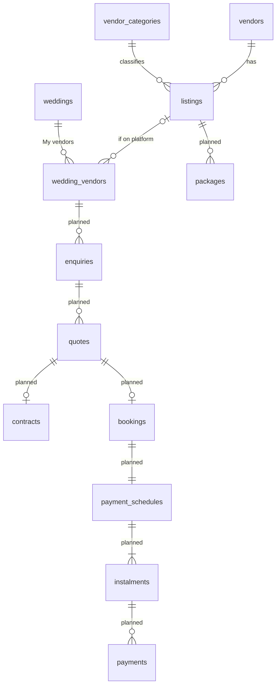
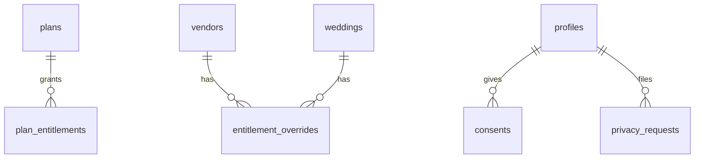

# Data model

Source of truth: `supabase/migrations/`. This page summarises it. Tables marked _(planned)_
arrive in the phase shown; everything else exists in schema v1.

## Conventions

- Every tenant row has `wedding_id` or `vendor_id`; RLS enforces it on every table.
- Money: `bigint` minor units + `currency_code`. Time: `timestamptz` UTC + IANA zone per
  wedding/event. Status: `text` + `CHECK`.
- Soft delete (`deleted_at`) and `audit_log` triggers on guests, households, members,
  invites, payments (and contracts/signatures when they arrive).
- Permission helpers live in `app_private` (not exposed through the API):
  `has_wedding_access(wedding_id, module, 'view'|'edit')`, `is_task_assignee(task_id)`,
  `has_vendor_role(vendor_id, min_role)`, `is_staff(roles)`.

## Identity, weddings and collaboration (v1)

## Guests and RSVP (v1) and seating (Phase 5)

## Planning and budget (v1); run-of-show (Phase 5)

## Vendors (v1 basics; deals in Phases 2–3)

## Business and platform (v1)

Also: `feature_flags`, `audit_log`.

Planned later: messaging (`conversations`, `messages`), content (`websites`,
`website_sections`, `invitation_designs`, `mood_boards`, `documents`), guest media
(`albums`, `photos`, `guestbook_entries`), gifts (`registry_links`, `gifts`, `thank_yous`),
money (`payouts`, `refunds`, `ledger_entries`, `stripe_events`), AI (`ai_conversations`,
`ai_usage`), and `subscriptions`/`promo_codes`. The full proposed diagrams are in the Phase 0
proposal and will be added here as each table lands.
